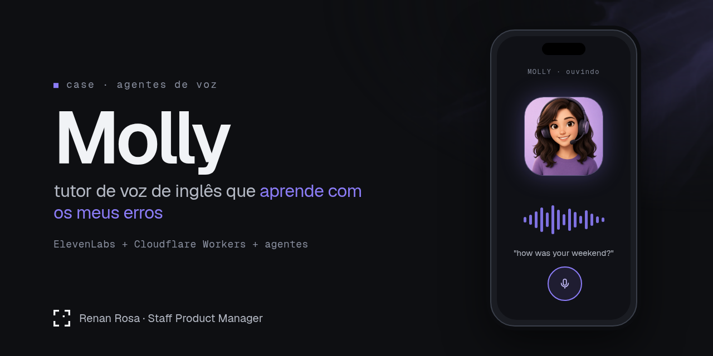

<p align="center"></p>

# Molly — tutora de inglês por voz (motion case)

> **English summary:** 20-second vertical (1080x1920) motion piece made with Remotion telling the case of *Molly*, Renan Rosa's personal English voice tutor: an ElevenLabs Conversational AI tutor, transcripts bridged twice a day by Grok Bot to a gamified teacher agent (lessons, quizzes, XP, streaks — Duolingo-style). This repo holds the final video, the Remotion source, the brief/style guide/shotlist, the review artifacts from each production gate and the case write-up, so anyone can reproduce or adapt it.

## O que é
Um vídeo de 20s (9:16) que conta o case: "não construí um app de inglês. montei um tutor de voz que aprende com os meus erros."
O case completo (problema, decisões, trade-offs, arquitetura, métricas) está em [`case/case.md`](case/case.md). Métricas ainda sem dado ficam marcadas como `[PREENCHER]`.

## Vídeo
https://github.com/rxrenan/molly-english-tutor-motion/raw/main/video/tutora-final-1080x1920.mp4

Arquivo: [`video/tutora-final-1080x1920.mp4`](video/tutora-final-1080x1920.mp4) (1080x1920, 20s, ~2.4 MB).

## Stack
- **Grok Bot** — assistente que roteirizou, produziu o motion e faz a ponte das transcrições (rotina 13h/21h BRT).
- **ElevenLabs** — Conversational AI do tutor de voz (voz Sarah, `eleven_flash_v2`).
- **Remotion** (React + TypeScript, `@remotion/three`) — renderização do vídeo, 0 créditos.

## Como reproduzir
Pré-requisitos: Node.js 18+ e npm.
```bash
npm install
npx remotion studio src/index.ts          # preview
npx remotion render src/index.ts Tutora out/x.mp4 --gl=swangle --crf=18 --pixel-format=yuv420p
```
A composição final é `Tutora` (`src/Tutora.tsx`). `TutoraV1–V3` são as iterações anteriores, mantidas para referência. Nenhuma chave de API é necessária para renderizar.

## Processo (gates do motion-reel)
1. **Brief** — [`brief.md`](brief.md), [`style_guide.md`](style_guide.md), [`shotlist.md`](shotlist.md).
2. **Stills** — quadros-chave em [`reviews/stills/`](reviews/stills).
3. **Animatic em baixa resolução** (540x960) com contact sheet e notas — [`reviews/`](reviews) (`animatic-contact.png`, `animatic-scores.md`, `v2/`, `v3/`, `v4/`).
4. **Final** — render 1080x1920 em [`video/`](video).

## Estrutura
```
src/        código Remotion (Root, Tutora, tokens, versões anteriores)
public/     assets usados no render (Molly, Grok Bot, fontes Geist)
assets/     cópia dos assets originais
reviews/    artefatos de revisão de cada gate
case/       case.md
video/      vídeo final
```

## Licença
**Sem licença definida.** O repo inclui material de terceiros que não pode ser relicenciado como MIT (marcas Grok Bot, ElevenLabs e a referência a Duolingo pertencem aos seus donos; fontes Geist sob a licença própria — SIL OFL). Por isso nenhuma licença open source foi aplicada: o conteúdo é publicado para estudo e referência. Para reutilizar o código, abra uma issue.

> As versões antigas `TutoraV1` e `TutoraV2` usavam uma imagem de terceiros que foi removida; só a composição final `Tutora` renderiza sem ajustes.
