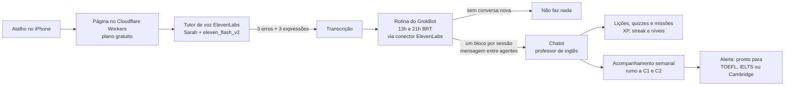

# Case: Duolingo pessoal de inglês com agentes (rascunho)

*Rascunho privado de portfólio. Renan Rosa, Staff Product Manager em transição para PM de IA. Nada aqui vai a público sem o OK do Renan.*

**Legenda:** [PREENCHER] = dado ou número que ainda falta. [A CONFIRMAR] = hipótese de raciocínio que o Renan precisa validar antes de publicar.

---

## 1. Narrativa

### O problema

Aprender inglês de verdade, até o nível de usar no trabalho, exige prática de fala frequente, correção honesta e um jeito de não desistir no meio do caminho. Curso tradicional costuma falhar em pelo menos um desses três pontos: pouca fala, correção genérica e motivação que some depois de algumas semanas.

### O contexto

Eu estava num curso de inglês pago e desisti quando descobri que quem dava a aula era uma IA. Não foi uma questão de ser contra IA. Foi o contrário: se a aula já era feita por IA, eu estava pagando por uma experiência genérica, montada para qualquer aluno, sem olhar para os meus erros de verdade.

### O insight

Se a IA já consegue ser o professor, o valor não está no professor em si. Está em três coisas: **personalização** (aprender a partir dos meus erros reais, não de uma apostila), **acesso sem atrito** (falar na hora em que dá vontade, sem abrir mais um app) e **constância** (um motivo para voltar todo dia). Dava para montar isso sozinho, juntando peças que já existem.

### As decisões e os trade-offs

**Voz em vez de app.** A escolha principal foi não construir um app. O tutor é uma página no Cloudflare Workers salva como atalho no iPhone: toco no ícone e começo a falar. Isso conversa com uma tese que eu venho defendendo, a de **menos telas**: voz e mensagens no lugar de mais um aplicativo. O trade-off é claro. Perco o que um app dá de graça (notificações nativas, interface rica, telas de progresso) e ganho uma experiência que começa em um toque e treina exatamente o que eu quero melhorar, que é falar.

**Agentes separados em vez de um tutor único.** Em vez de um único tutor fazendo tudo, o trabalho foi dividido: o tutor de voz conversa e corrige, o GrokBot leva as transcrições, e o Chatot cuida do ensino e da gamificação. Hipótese de raciocínio [A CONFIRMAR]: cada parte tem uma exigência diferente. A conversa precisa ser rápida e natural, enquanto montar lição, quiz e missão pede memória do histórico e mais tempo para pensar. Separar deixa cada agente bom em uma coisa só. O custo é ter mais peças para manter e um ponto de passagem (as transcrições) que precisa funcionar sempre.

**Rotina em horário fixo em vez de tempo real.** As transcrições não vão para o Chatot no fim de cada conversa. Uma rotina roda todo dia por volta das 13h e das 21h (horário de Brasília) e, se não houver conversa nova, não faz nada. Hipótese de raciocínio [A CONFIRMAR]: dois lotes por dia bastam para virar lição e missão, mantêm o sistema simples e evitam mensagem sem conteúdo. O trade-off é que o feedback gamificado chega com algumas horas de atraso.

**Mensagem entre agentes, sem WhatsApp.** O GrokBot fala direto com o Chatot, de agente para agente, e eu uso o Chatot no chat do próprio app. Menos uma integração para manter e menos um canal para eu olhar.

**Modelo flash para a conversa.** O tutor usa a voz Sarah com o modelo eleven_flash_v2. Hipótese de raciocínio [A CONFIRMAR]: em conversa falada, demora na resposta quebra o ritmo e faz a prática parecer artificial, então um modelo voltado para baixa latência tende a valer mais do que um modelo mais pesado. O trade-off provável é abrir mão de alguma riqueza de voz em troca de fluidez [A CONFIRMAR].

**Formato STAR no treino.** O tutor treina respostas no formato STAR, que é o formato de entrevista comportamental. Hipótese de raciocínio [A CONFIRMAR]: é uma decisão de foco, treinar um uso concreto do inglês em vez de conversa genérica.

**Fechamento curto de cada conversa.** Toda conversa termina com 3 erros e 3 expressões novas. É pouco de propósito: um resumo que dá para lembrar, e não um relatório que ninguém lê.

### O que foi construído

- **Tutor de voz:** ElevenLabs Conversational AI, voz Sarah, modelo eleven_flash_v2, rodando numa página no Cloudflare Workers (plano gratuito) salva como atalho no iPhone. Corrige minha fala, treina respostas no formato STAR e fecha cada conversa com 3 erros e 3 expressões novas.
- **Ponte de dados:** o GrokBot, um assistente, tem uma rotina que roda todo dia por volta das 13h e das 21h (horário de Brasília). Ela lista as conversas novas pelo conector da ElevenLabs e monta um bloco por sessão com tema, duração, % do tempo de fala, erros com a correção e o tipo, expressões novas, sinais de nível CEFR e trechos literais. Depois envia tudo para o Chatot. Se não houver conversa nova, não faz nada.
- **Professor gamificado:** o Chatot, assistente professor de inglês, transforma meus erros reais em lições, quizzes e missões, com XP, streak e níveis. O GrokBot entrega as transcrições por mensagem direta entre agentes, sem WhatsApp, e eu uso o Chatot no chat do app.
- **Meta e acompanhamento:** chegar ao C1 e depois ao C2 na escala CEFR, com teste de nivelamento, acompanhamento semanal e um alerta para quando eu estiver pronto para fazer TOEFL, IELTS ou Cambridge. O teste de nivelamento do Chatot já foi feito em 20/10 (resultado na tabela de métricas). Status do acompanhamento semanal e do alerta de prova (no ar ou próximo passo): [PREENCHER].
- **Tempo de construção:** cerca de 30 minutos, em 30/10/2026.
- **Repositório:** ainda não existe repo no GitHub. Link: https://github.com/rxrenan/molly-english-tutor-motion.

### Arquitetura

O fluxo é simples:

1. Toco no atalho do iPhone e abro a página no Cloudflare Workers (plano gratuito).
2. Converso por voz com o tutor (ElevenLabs Conversational AI, voz Sarah, eleven_flash_v2).
3. O tutor corrige durante a conversa e fecha com 3 erros e 3 expressões novas.
4. Todo dia, por volta das 13h e das 21h (horário de Brasília), uma rotina do GrokBot lista as conversas novas pelo conector da ElevenLabs, monta um bloco por sessão (tema, duração, % de fala, erros com correção e tipo, expressões novas, sinais de CEFR e trechos literais) e manda para o Chatot por mensagem entre agentes. Sem conversa nova, não faz nada.
5. O Chatot gera lições, quizzes e missões a partir dos erros reais e atualiza XP, streak e nível.
6. O acompanhamento semanal mostra a evolução rumo ao C1 e ao C2, e o alerta avisa quando faz sentido marcar TOEFL, IELTS ou Cambridge.

### Métricas de sucesso

Ainda não há métricas de uso coletadas, então os valores de uso ficam em aberto até existirem dados reais. O único dado já disponível é o ponto de partida do teste de nivelamento.

| Métrica | Por que importa | Valor |
|---|---|---|
| Nível CEFR no teste de nivelamento (ponto de partida) | Linha de base para medir evolução | A2, com leitura perto de B1 (teste do Chatot em 20/10) |
| Nível CEFR atual | Mostra se a meta C1, depois C2, está andando | [PREENCHER] |
| Conversas de voz por semana | Mede se o acesso sem atrito virou hábito | [PREENCHER] |
| Streak atual e maior streak | Mede constância, o ponto onde cursos costumam falhar | [PREENCHER] |
| XP acumulado e nível no Chatot | Mede engajamento com a gamificação | [PREENCHER] |
| Taxa de conclusão de missões e quizzes | Mostra se o conteúdo gerado dos erros é útil | [PREENCHER] |
| Recorrência dos mesmos erros ao longo das semanas | Mostra se a correção está virando aprendizado | [PREENCHER] |
| Tempo de resposta percebido do tutor | Valida a escolha do modelo flash | [PREENCHER] |
| Semanas até o alerta de prova | Mede a velocidade até estar pronto para TOEFL, IELTS ou Cambridge | [PREENCHER] |

### Aprendizados de PM de IA

- **Quando a IA vira commodity, o produto é o contexto.** O curso que eu larguei também usava IA. A diferença está em usar os meus erros reais como matéria-prima.
- **A melhor interface às vezes é nenhuma.** Voz e mensagens tiraram o atrito de abrir um app. Menos telas não é falta de produto, é uma decisão de produto.
- **Dividir agentes é uma decisão de produto, não só técnica.** Cada agente com um papel claro fica mais fácil de avaliar e melhorar, mas a passagem entre eles vira um ponto crítico.
- **Latência é experiência.** Em voz, a escolha do modelo aparece direto na sensação de conversa [A CONFIRMAR].
- **Defina o fim de cada interação.** Fechar com 3 erros e 3 expressões transforma uma conversa solta em algo com resultado.
- **Meta clara orienta o sistema inteiro.** C1, depois C2, com teste de nivelamento, acompanhamento semanal e alerta de prova dá direção para tudo o que o Chatot gera.
- Aprendizado adicional do Renan: [PREENCHER].

---

## 2. Estrutura sugerida do README do repo

### Duolingo pessoal de inglês com agentes
#### Em uma frase
#### Por que eu construí isso
#### Como funciona
##### Tutor de voz (ElevenLabs + Cloudflare Workers)
##### Ponte de transcrições (GrokBot)
##### Professor gamificado (Chatot)
#### Arquitetura
##### Diagrama do fluxo
##### Decisões e trade-offs
#### Meta: C1, depois C2 (CEFR)
##### Teste de nivelamento
##### Acompanhamento semanal
##### Alerta de prova (TOEFL, IELTS, Cambridge)
#### Como rodar
##### Pré-requisitos
##### Configuração (variáveis de ambiente, sem chaves no repo)
##### Deploy no Cloudflare Workers (plano gratuito)
##### Salvar como atalho no iPhone
#### Métricas
#### Limitações conhecidas
#### Próximos passos
#### Licença

---

## 3. Roteiro de divulgação

**Importante:** nada deste roteiro vai a público sem o OK do Renan. Isso vale para o post, o vídeo, o repositório e a página de portfólio.

### Rascunho do post no LinkedIn

desisti de um curso de inglês pago no dia em que descobri que quem dava a aula era uma IA. se o professor ia ser IA de qualquer jeito, eu preferia montar o meu, feito a partir dos meus próprios erros. hoje eu toco num atalho no iPhone e converso com um tutor de voz feito com ElevenLabs, rodando numa página no Cloudflare Workers. ele corrige minha fala, treina respostas no formato STAR e fecha cada conversa com 3 erros e 3 expressões novas. duas vezes por dia o GrokBot pega as transcrições e entrega para o Chatot, meu professor de inglês, que transforma esses erros em lições, quizzes e missões com XP, streak e nível. é um Duolingo pessoal, só que sem app, só voz e mensagem... e a meta é chegar no C1 e depois no C2. montei tudo em uns 30 minutos, e o maior aprendizado de produto até aqui foi simples: menos tela, mais conversa.

#ia #produto #inglês

### Plano de divulgação

1. **Revisão e aprovação:** o Renan revisa este case, preenche os [PREENCHER], valida os [A CONFIRMAR] e dá o OK. Data: [PREENCHER].
2. **Repositório:** criar o repo no GitHub (ainda não existe) e publicar com o README acima, sem chaves, tokens ou transcrições pessoais. Link: [PREENCHER].
3. **Vídeo de demo:** gravar um vídeo curto mostrando o atalho no iPhone, um trecho de conversa com o tutor, o fechamento com 3 erros e 3 expressões, e a missão gerada pelo Chatot. Duração e link: [PREENCHER].
4. **Post no LinkedIn:** publicar o post acima com o vídeo de demo, só depois do OK do Renan. Data: [PREENCHER].
5. **Portfólio:** adicionar o case na página de portfólio, com link para o repo e para o vídeo. Link: [PREENCHER].
